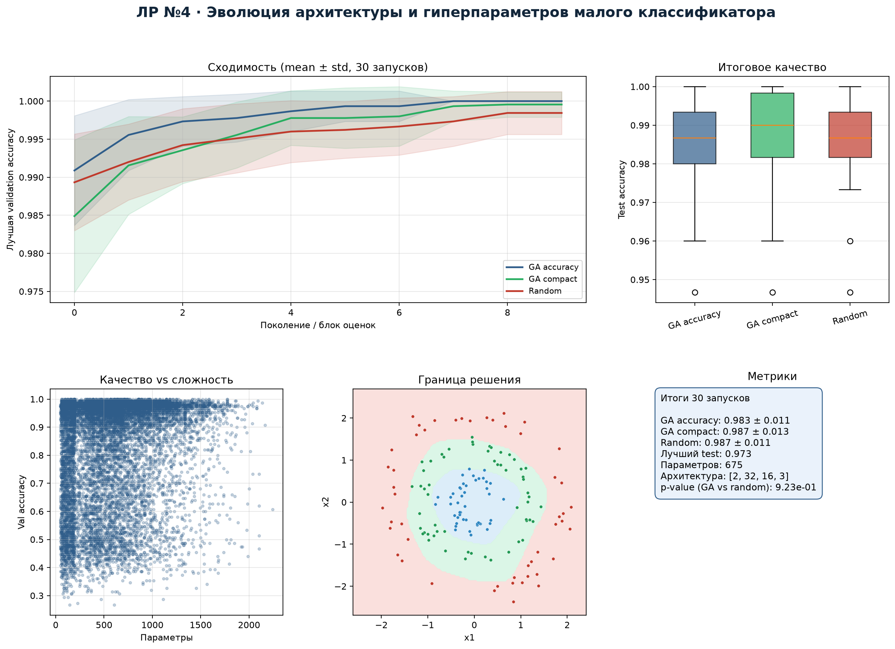
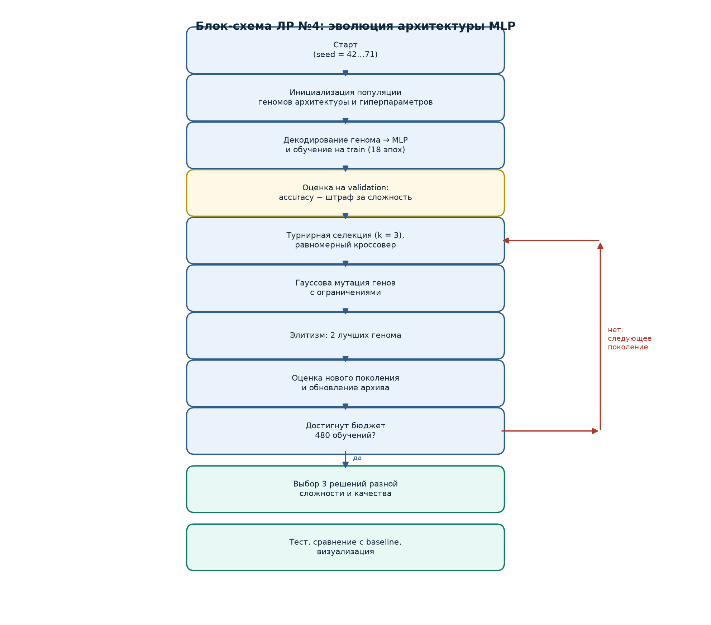
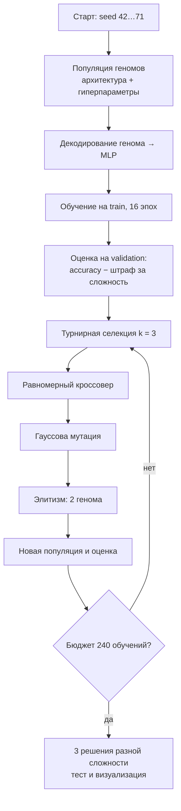
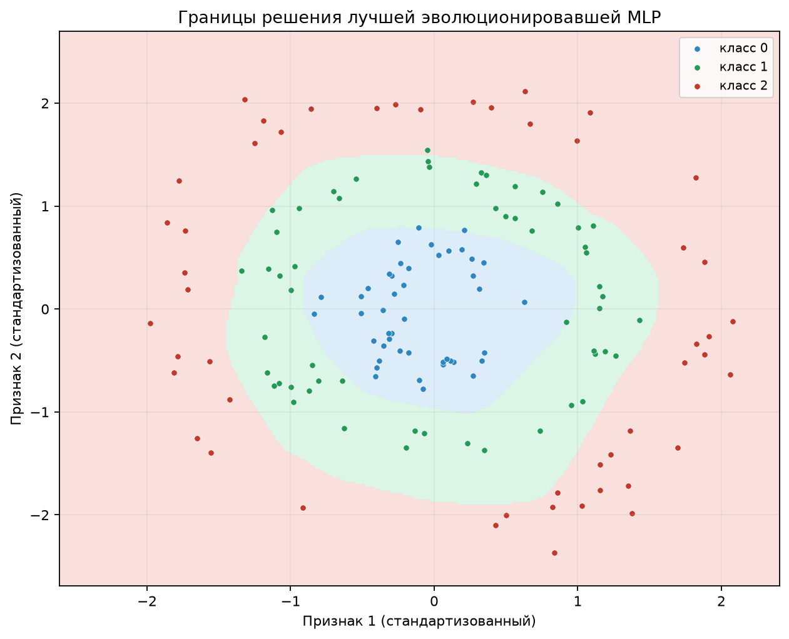
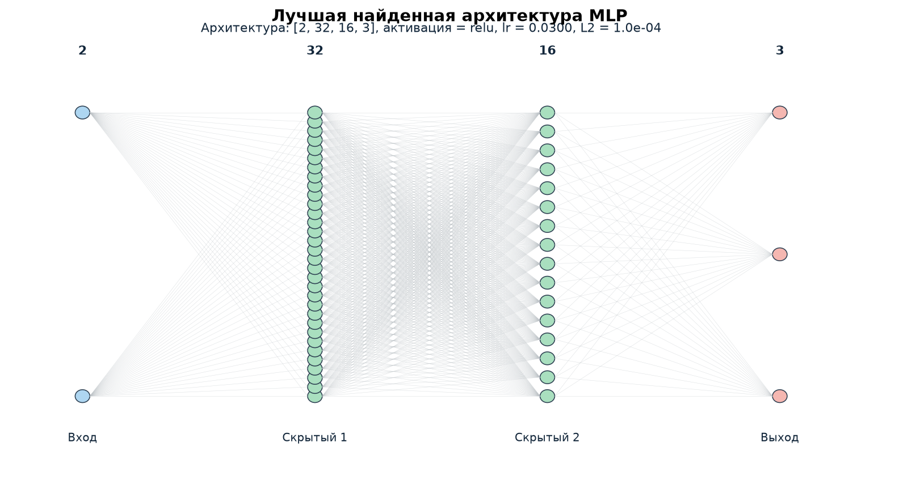
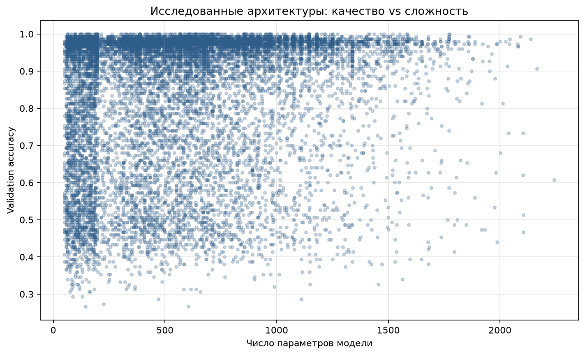

# Лабораторная работа №4
## Эволюция архитектуры и гиперпараметров малого классификатора


**Студент:** Якимов Максим Андреевич  
**Группа:** Б24-517, № в группе 30  
**Вариант:** 4, проект «со звёздочкой»  
**Дисциплина:** «Эволюционное программирование и генетические алгоритмы»

---

## Дашборд



## Блок-схема





## Постановка задачи

Дан синтетический трёхклассовый набор (три концентрических кольца, 750
объектов, шум). Нужно эволюционно подобрать архитектуру и гиперпараметры
малой MLP при бюджете **240 обучений** на запуск и 30 независимых запусках.

**Геном:** 8 генов — число скрытых слоёв, нейроны по слоям, активация,
$\log_{10}$ learning rate, $\log_{10} L_2$, размер батча.

**MLP реализована с нуля на NumPy:** прямой/обратный проход, softmax,
кросс-энтропия, SGD с momentum, $L_2$.

## Результаты 30 запусков

| Стратегия | Test accuracy | Среднее число параметров |
|---|---:|---:|
| GA accuracy | 0.983 ± 0.011 | 639.0 |
| **GA compact** | **0.987 ± 0.013** | **137.5** |
| Random search | 0.987 ± 0.011 | 653.2 |
| Baseline: логистическая регрессия | 0.280 | 9 |
| Baseline: ручная MLP | 0.873 | 675 |

GA compact в **4.6 раза** компактнее GA accuracy и не теряет качества.
Различие GA и random search статистически незначимо (Mann—Whitney,
$p=0.923$) — на малом пространстве гиперпараметров случайный поиск силён.

## Характерные решения

| Решение | Параметры | Архитектура | Val acc | Test acc |
|---|---:|---|---:|---:|
| Компактное | 51 | 1×8, ReLU | 0.973 | 0.953 |
| Сбалансированное | 63 | 1×10, ReLU | 1.000 | **0.987** |
| Максимальная точность | 675 | 2×32×16, ReLU | 1.000 | 0.973 |







## Быстрый запуск

```bash
pip install -r requirements.txt
python main.py
```

Результаты в `lab4_out/`:

- `lab4_runs.csv` — 30 запусков трёх стратегий;
- `lab4_history.csv` — траектории сходимости;
- `lab4_representatives.csv` — три характерные модели;
- `lab4_summary.json` — итоговая статистика;
- `lab4_dashboard.png`, `lab4_convergence.png`, `lab4_block_schema.png`.

## Отчёт

Готовый PDF: [`report.pdf`](report.pdf). Исходник: [`report.md`](report.md).
