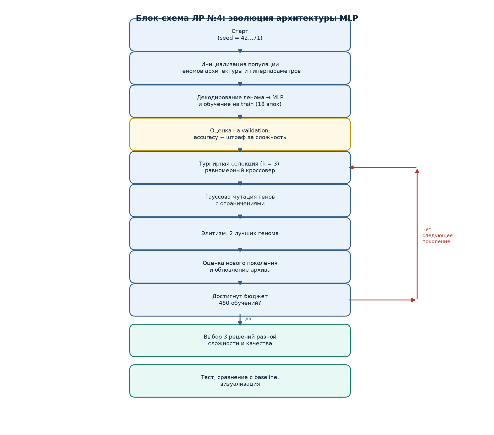
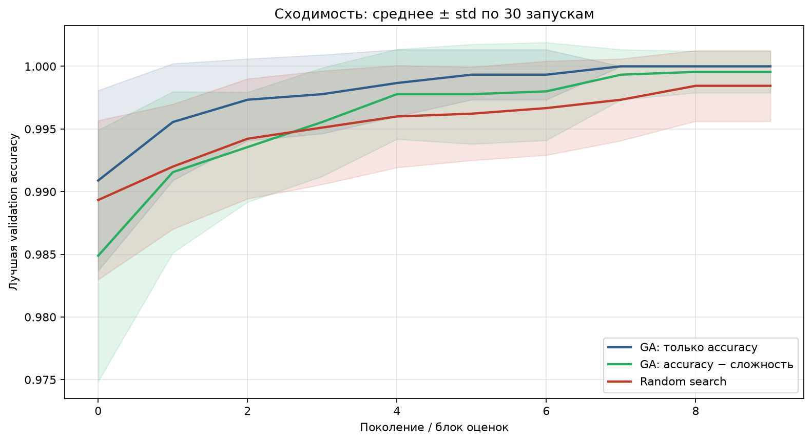
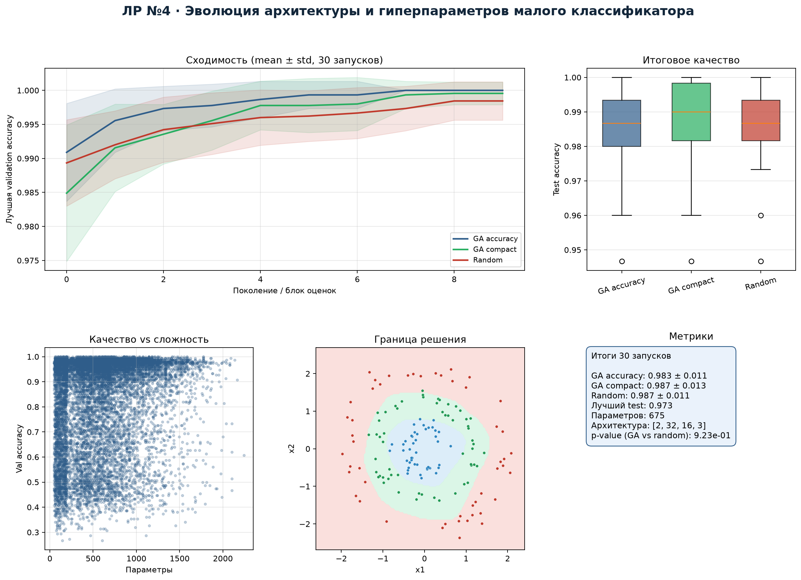
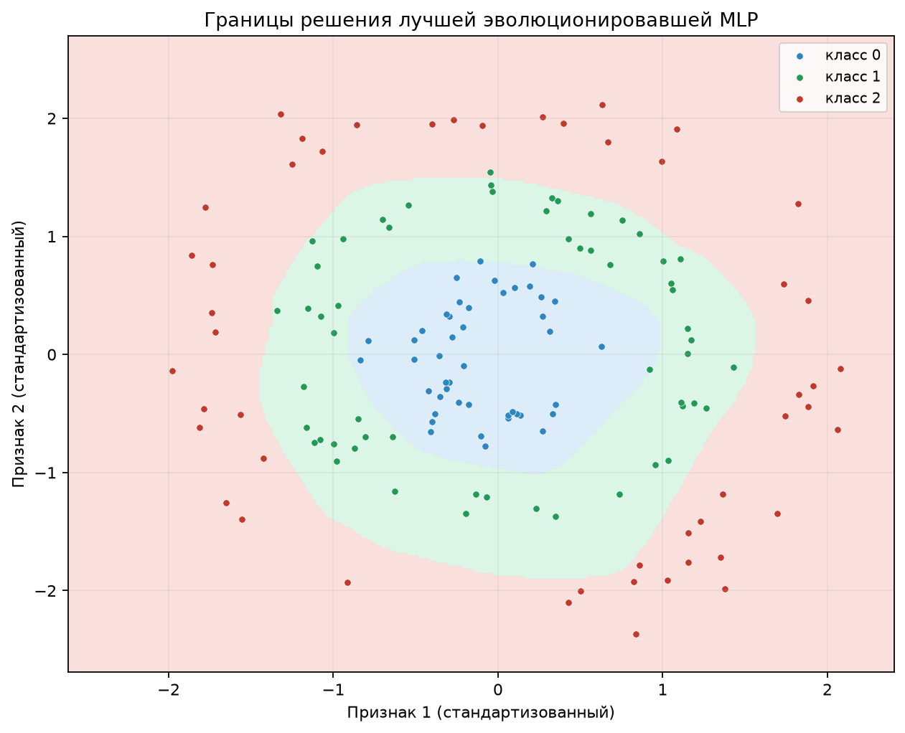
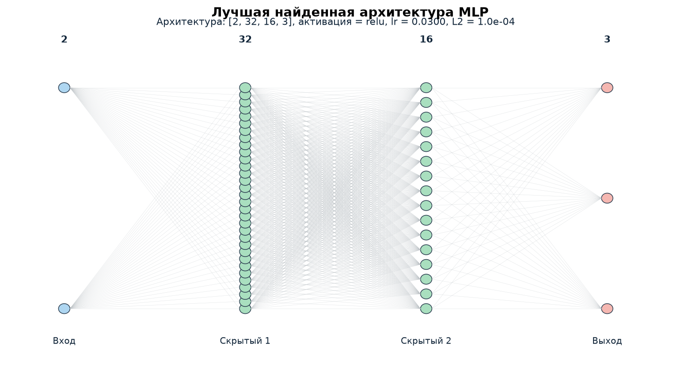

# 1. Постановка задачи и вариант

**Вариант:** 4, проектная работа «со звёздочкой»: эволюция нейросетевой
архитектуры или гиперпараметров малого классификатора при ограниченном
бюджете вычислений.

**Задача:** для синтетического трёхклассового набора данных подобрать
архитектуру и гиперпараметры малой полносвязной нейронной сети, максимизируя
качество классификации при ограниченном числе обучений. Дополнительно
исследуется компромисс «качество — сложность модели».

# 2. Данные и постановка эксперимента

Сгенерированы три концентрических класса (кольца) по 250 точек; признаки —
две координаты, добавлен гауссов шум. Фиксированный seed — 42. Выборка
разделена на train/validation/test в пропорции 60/20/20: 450, 150 и 150
объектов.

Такая задача не решается линейным классификатором: класс определяется
радиусом, а не линейной комбинацией координат. Поэтому разница между
архитектурами проявляется отчётливо.

# 3. Представление особи

Геном — вещественный вектор из 8 генов:

| Ген | Смысл | Диапазон |
|---|---|---|
| $g_0$ | число скрытых слоёв | 1–3 |
| $g_1,g_2,g_3$ | число нейронов в слоях | 8–32 |
| $g_4$ | активация (0 — tanh, 1 — ReLU) | 0/1 |
| $g_5$ | $\log_{10}$ скорости обучения | $-2.7$…$-1.0$ |
| $g_6$ | $\log_{10}$ коэффициента $L_2$ | $-6$…$-3$ |
| $g_7$ | размер мини-батча | 32/64/96 |

Декодирование округляет целочисленные гены и переводит логарифмы в
действительные значения. Все гены ограничены; после кроссовера и мутации
выполняется clip.

# 4. Алгоритм

- Популяция 24, 9 поколений, бюджет **240 обучений** на один запуск.
- Турнирная селекция $k=3$, равномерный кроссовер ($p_c=0.9$), гауссова
  мутация ($p_m=0.2$, $\sigma=0.12$ от диапазона гена), элитизм 2 особи.
- Фитнес: accuracy на validation. В варианте `compact` используется
  $f=\text{val\_acc}-5\cdot10^{-5}\cdot\text{params}-0.001\cdot(\text{layers}-1)$.
- MLP реализован с нуля на NumPy: прямой и обратный проход, softmax,
  кросс-энтропия, SGD с momentum 0.9, $L_2$-регуляризация.
- 30 независимых запусков (seed 42…71) для трёх стратегий:
  `ga_accuracy`, `ga_compact`, `random_search` при одинаковом бюджете.

# 5. Блок-схема

# 6. Результаты 30 запусков

| Стратегия | Test accuracy, mean ± std | Среднее число параметров |
|---|---:|---:|
| GA accuracy | 0.983 ± 0.011 | 639 |
| GA compact | **0.987 ± 0.013** | **137.5** |
| Random search | 0.987 ± 0.011 | 653 |
| Baseline: логистическая регрессия | 0.280 | 9 |
| Baseline: ручная MLP | 0.873 | 675 |

Различие GA и случайного поиска по test accuracy статистически незначимо
(критерий Манна—Уитни, $p=0.923$). Это честный результат: пространство
гиперпараметров малой размерности, и случайный поиск при 240 обучениях
оказывается сильным конкурентом.

# 7. Компромисс «качество — сложность»

Вариант `ga_compact` с штрафом за число параметров находит модели в среднем
в **4.6 раза меньше** (137.5 против 639 параметров), не теряя, а по данной
выборке даже немного улучшая test accuracy. Это объясняется регуляризующим
эффектом малых архитектур: на 450 обучающих объектах большая сеть склонна
к переобучению.

Три характерных решения:

| Решение | Параметры | Архитектура | Val acc | Test acc |
|---|---:|---|---:|---:|
| Компактное | 51 | 1×8, ReLU | 0.973 | 0.953 |
| Сбалансированное | 63 | 1×10, ReLU | 1.000 | **0.987** |
| Максимальная точность | 675 | 2×32×16, ReLU | 1.000 | 0.973 |

Лучшая по validation accuracy модель имеет архитектуру $[2,32,16,3]$,
ReLU, lr $\approx0.03$, $L_2=10^{-4}$, batch 64; её test accuracy 0.973.
При этом сбалансированная модель с 63 параметрами даёт 0.987 — настолько
мал набор данных, что более простая модель обобщает лучше.

# 8. Анализ ограничений бюджета

Суммарно выполнено $3\cdot30\cdot240=21\,600$ обучений. При 16 эпохах и
450 объектах это порядка $10^7$ обновлений параметров — небольшой, но
достаточный бюджет для задачи. Увеличение бюджета до 1000 обучений на запуск
и переход к реальным табличным данным — естественные направления развития.
Основное ограничение работы: синтетическая задача и малая размерность
гиперпараметров, из-за чего случайный поиск конкурентоспособен.

# 9. Выводы

1. Генетический алгоритм корректно эволюционирует одновременно архитектуру
   (число слоёв и нейронов) и гиперпараметры (активация, lr, $L_2$, batch).
2. Штраф за сложность сокращает модель в 4.6 раза без потери качества,
   что важно при ограниченном бюджете вычислений и малой выборке.
3. На данной задаче GA и random search статистически неразличимы; это
   показывает, что преимущество эволюционного поиска проявляется на более
   сложных и многомерных пространствах архитектур.
4. Все ключевые части MLP и эволюционного алгоритма реализованы
   самостоятельно; эксперимент воспроизводим по seed и requirements.
